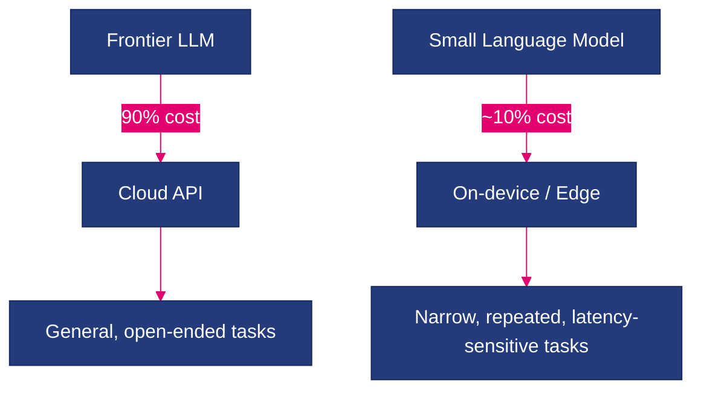
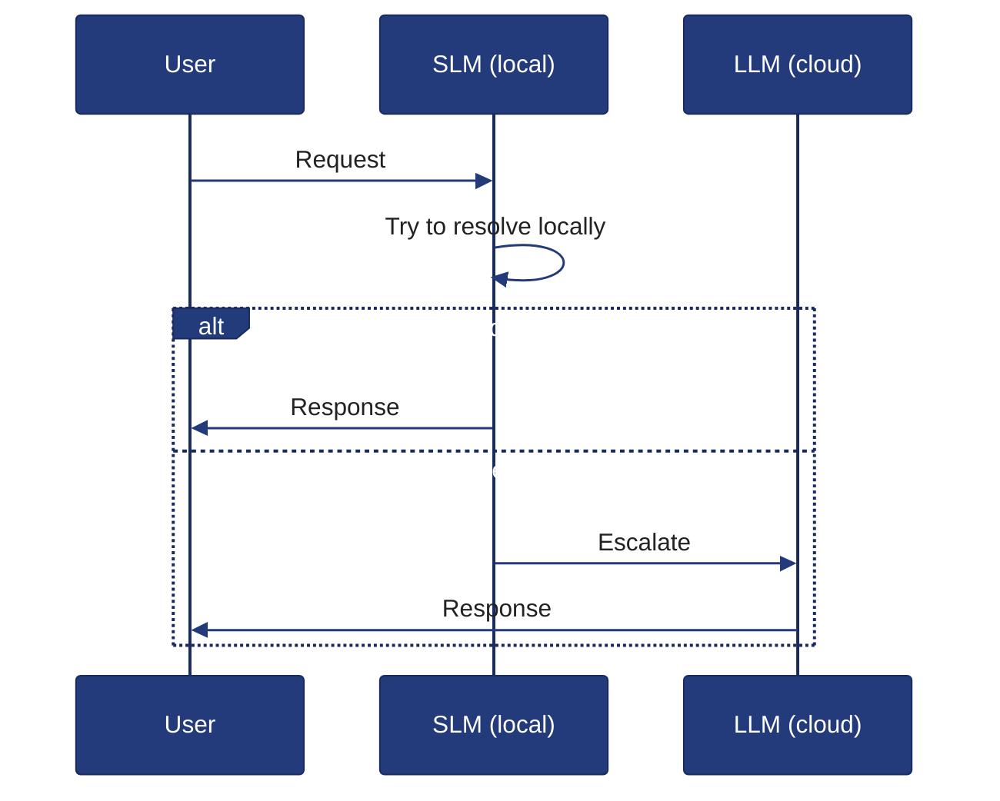
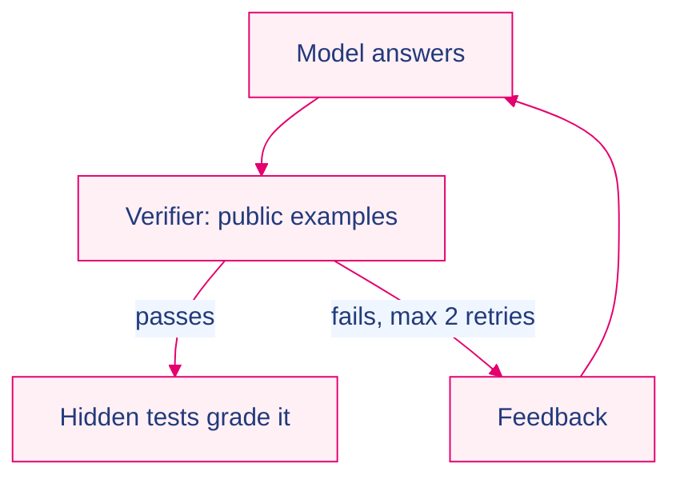

# Small Language Models

## The Year Bigger Stopped Meaning Better

Benchmarking on a laptop CPU5 models40 tasks5 seedsOctober 2026

<!--
Opening slide for the SLM project presentation.
-->

---
transition: fade-out
---

# What Is a Small Language Model?

A language model built for **efficiency over scale** — typically under 40B parameters,
often in the **1–13B** range.

<v-clicks>

- Runs on consumer hardware: laptops, phones, edge devices
- Lower training and inference cost than frontier LLMs
- Can be fine-tuned and deployed in-house, without API dependency
- Trades some raw capability for speed, cost, and data locality

</v-clicks>

 

<v-click>

> In 2026, 1–13B models like Phi-4, Gemma 4, and Qwen3 deliver roughly
> **90% of frontier capability at ~10% of the cost**.

</v-click>

---
layout: two-cols
layoutClass: gap-16
---

# Why SLMs Now?

<v-clicks>

- **Cost** — inference bills scale with every call; smaller models cut compute cost dramatically
- **Latency** — real-time, on-device response without a round-trip to the cloud
- **Privacy** — sensitive data never leaves the device
- **Sustainability** — far lower energy footprint per query
- **Customization** — easy to fine-tune for a narrow, well-defined task

</v-clicks>

::right::

<v-click>

</v-click>

---
class: bottom-band-only
---

# The 2026 Landscape

Leading small language models this year span on-device, multilingual, and coding use cases.

<table><thead><tr><th>Model</th><th>Maker</th><th>Focus</th></tr></thead><tbody>
<tr><td>Phi-4</td><td>Microsoft</td><td>General reasoning, on-device</td></tr>
<tr><td>Gemma 4</td><td>Google</td><td>Multimodal, efficient</td></tr>
<tr><td>Qwen3</td><td>Alibaba</td><td>Multilingual, open-weight</td></tr>
<tr><td>Ministral 3</td><td>Mistral</td><td>Edge deployment</td></tr>
<tr><td>Nemotron 3 Nano</td><td>NVIDIA</td><td>Agentic / tool use</td></tr>
<tr><td>Tiny Aya</td><td>Cohere</td><td>Multilingual</td></tr>
</tbody></table>
<table><thead><tr><th>Model</th><th>Maker</th><th>Focus</th></tr></thead><tbody>
<tr><td>Granite 4.1</td><td>IBM</td><td>Enterprise / RAG</td></tr>
<tr><td>SmolLM3</td><td>Hugging Face</td><td>Fully open, community</td></tr>
<tr><td>GPT-5.4 mini</td><td>OpenAI</td><td>General-purpose mini</td></tr>
<tr><td>North Mini Code</td><td>—</td><td>Coding agent</td></tr>
<tr><td>Ornith-1.0-9B / 31B</td><td>DeepReinforce</td><td>Self-scaffolding agentic coding</td></tr>
</tbody></table>

<!--
Table compiled from 2026 industry roundups (DataCamp, TuringPost, Intuz).
-->

---

# How Do You Get to "Small"?

<v-clicks>

  
<carbon:flow-data />

  
Distillation

  
Train a small "student" model to mimic a larger "teacher"

  
<carbon:transform-binary />

  
Quantization

  
Reduce weight precision (FP16 → INT8/INT4) with minimal quality loss

  
<carbon:tree />

  
Pruning

  
Remove redundant weights or attention heads

  
<carbon:chart-network />

  
Mixture-of-Experts

  
Activate only a subset of parameters per token

  
<carbon:data-dictionary />

  
Dynamic Vocabulary

  
Trim the tokenizer/vocab to the deployment domain

  
<carbon:model-tuned />

  
Targeted Fine-tuning

  
Specialize on a narrow task instead of general-purpose breadth

</v-clicks>

---

# SLMs vs. LLMs

<h3><carbon:chip class="inline mr-1" />Small Language Model</h3>

Parameters~1–13B

DeploymentEdge, on-device, local

Cost per queryLow

LatencyMilliseconds

Breadth of knowledgeNarrow / fine-tuned

Best forRepeated, well-defined tasks

<h3><carbon:cloud class="inline mr-1" />Large Language Model</h3>

Parameters70B–1T+

DeploymentCloud, data center

Cost per queryHigh

LatencySeconds (network + compute)

Breadth of knowledgeBroad / general

Best forOpen-ended reasoning, novel tasks

<v-click>

Increasingly, these aren't competitors — they're <strong>collaborators</strong>.

</v-click>

---
class: bottom-band-only
---

# The Hybrid Pattern

Most 2026 production systems route between tiers rather than picking one model.

<v-click>

SLM handles the common case fast and cheap; the LLM is the fallback for the hard 10%.

</v-click>

---

# Where SLMs Shine

<v-clicks>

  
<carbon:mobile />

  
On-device Assistants

  
Phones, wearables, offline-first apps

  
<carbon:chip />

  
Agentic Tool-use

  
Fast function-calling loops (RL-tuned, e.g. Nemotron 3 Nano)

  
<carbon:book />

  
Enterprise RAG

  
Narrow-domain Q&A over private documents

  
<carbon:code />

  
Coding Copilots

  
Specialized, low-latency code completion

  
<carbon:globe />

  
Multilingual

  
Models like Tiny Aya cover languages frontier LLMs skip

  
<carbon:locked />

  
Regulated Industries

  
Healthcare, finance: data never leaves the perimeter

</v-clicks>

---
class: bottom-band-only
---

# Limitations to Plan Around

<v-clicks>

- Narrower general knowledge — weaker on open-ended, novel reasoning
- Smaller context windows in many SLM variants
- Fine-tuning quality depends heavily on training data curation
- Still evolving tooling for multi-agent SLM↔LLM orchestration
- "Small" is relative — a 13B edge model still needs real hardware planning

</v-clicks>

---

# GGUF: One File, Ready to Run

The single-file model format of **llama.cpp**, used by LM Studio and Ollama.

<v-clicks>

- **Weights** — stored already quantized, in blocks
- **Tokenizer** — vocabulary and special tokens
- **Metadata** — architecture, context length, chat template
- **Memory-mapped**: the OS loads pages from disk on demand, so start-up is fast and the file can be shared between processes

</v-clicks>

<h3><carbon:document class="inline mr-1" />Reading a file name</h3>

Ornith-1.5-9B-MTP-Q4_K_M.gguf5.8 GB

Ornith-1.5model family and version

9B9 billion parameters

MTPhas multi-token-prediction heads

Q4_K_Mquantization type (next page)

The same model usually ships in several GGUF variants; the quantization type in the name is the trade-off between size and quality.

---

# Quantization: Q4_K_M Explained

  
Q4

  
each weight stored in 4 bits instead of 16

  
K

  
k-quant: a scale per block of 32 weights

  
M

  
medium mix: key tensors get 6 bits

<v-clicks>

- **Q4**: a weight becomes an integer 0-15 — a much smaller file, a little accuracy lost. Smaller also means faster: every token reads every weight once
- **K**: weights are grouped in blocks of 32, each with its own scale and offset (weight ≈ integer × scale + offset), so one outlier distorts only its block. The scales add bits: **4.5 per weight**
- **M**: some tensors are too sensitive for 4 bits. In about half of the layers the attention-value and feed-forward-down tensors use 6-bit Q6_K. **S** (small) has none, **M** (medium) has these, **L** has more. Cost: ~0.3 bit → **≈ 4.9 bits per weight**

</v-clicks>

<table class="w-full"><thead><tr><th>9B model</th><th>Bits / weight</th><th>File size</th></tr></thead><tbody>
<tr><td>FP16 (original)</td><td>16</td><td>≈ 18 GB — too big for 15 GB RAM</td></tr>
<tr><td>Q8_0</td><td>≈ 8.5</td><td>≈ 9.6 GB</td></tr>
<tr><td>Q4_K_S</td><td>≈ 4.6</td><td>≈ 5.2 GB</td></tr>
<tr><td><strong>Q4_K_M (used here)</strong></td><td><strong>≈ 4.9-5.1</strong></td><td><strong>5.8 GB (the 9B files used)</strong></td></tr>
<tr><td>IQ3_M</td><td>≈ 4.2</td><td>4.7 GB — needs the recommended sampler</td></tr>
</tbody></table>

---

# MTP: Multi-Token Prediction

A normal model predicts **one** token per forward pass. An MTP model has extra heads, trained to also guess the tokens after it.

<v-clicks>

- **Draft**: the MTP heads propose the next 2 tokens (`--spec-draft-n-max 2`)
- **Verify**: the full model checks all of them in a single pass and keeps the ones it agrees with
- **Same output** as ordinary decoding — only faster, because a pass over the weights is the cost and it now yields more than one token
- No separate draft model needed; a mismatched 0.5B draft model we tried made things *slower*

</v-clicks>

  
3.7 → 4.7

  
tok/s, Ornith 9B without / with MTP

  
+27%

  
speed, same quality

<h3><carbon:terminal class="inline mr-1" />Server flags</h3>

<code>--spec-type draft-mtp --spec-draft-n-max 2</code>

---
layout: center
class: text-center divider-navy
---

# Benchmark: On Real Hardware

Intel Core i7-1165G7 laptop · CPU / iGPU · October 2026

Six small models tried (five benchmarked on 40 tasks), measured locally with llama.cpp (Vulkan backend) —
not vendor claims.

---

# Benchmark Methodology

**Setup**

<v-clicks>

- Models tested **naked** — plain chat completion, no tool access
  (Ornith's own scaffolding included, since nothing built it one here)
- Q4_K_M GGUFs, one `llama-server` instance per model, CPU with 4 threads, 4k context
- Temperature 0.6, top_p 0.95, top_k 20, `max_tokens` 512, thinking requested off
- **40 fixed tasks** per model: 8 regex, 12 Python, 10 kubectl, 5 SQL, 5 shell — every answer saved to
  its own file and graded automatically by hidden tests
- **5 seeds** (42–46) per model = 200 graded answers per model and condition; scores are mean ± SD
- The first 11 tasks are the original set (3 regex, 4 Python, 4 kubectl), kept as a comparable subset
- Vendor sampling re-tested on the 11-task set: **no gain** (spotlights)

</v-clicks>

5 seeds: a usable SD, but the questions (not the seeds) are the real sample — see the statistics.

**Grading**

<v-clicks>

- **Regex**: pattern compiled and checked with `re.fullmatch` against strings
  that must match and strings that must not
- **Python**: function extracted and run in a fresh `python3 -I` process against
  assertions; one function stress-tested on 200,000 elements within a 5 s budget
- **kubectl**: command must contain every required part (verb, resource,
  namespace, flags), in any order
- **SQL**: query run on a fixture database (SELECT only) and its rows compared with the expected rows
- **Shell**: command run in a sandbox (no network, throw-away files); its output compared with the expected output

</v-clicks>

 

**Harness experiment**

<v-click>

- Generate → **verify** against separate public examples → up to 2 **retries** with feedback;
  the hidden tests always do the grading

</v-click>

---

# The Harness, Step by Step

**What the verifier sees**

- **Regex**: 3 strings to match, 4-5 to reject
- **Python**: 3-4 example calls, plus a 20,000-element timing check
- **kubectl**: the real `kubectl` parser, offline, plus the task requirements
- **SQL / shell**: run on a small public fixture, different from the hidden one

The hidden tests have different cases and are never shown to the model or the verifier.

**Why these results are not artificial**

<v-clicks>

- **The verifier never decides the score** — every attempt, retries included, is graded by the hidden tests
- **Same request, same seed**: the first attempt is the plain run, and re-runs reproduce answers exactly (33 of 33 and 48 of 48 checked)
- **Safe execution**: model code runs in a fresh process, shell commands run in a sandbox with no network
- **Our own mistakes are public**: three grader bugs were found, fixed, and every saved answer re-graded — no model re-run to flatter a score
- **Limits stated**: 5 seeds, 40 questions; examples written by us after seeing the failures; it only works where an answer can be checked mechanically (tests, parsers, dry-runs)

</v-clicks>

---

# When a Harness Works in the Real World

<h3><carbon:checkmark-outline class="inline mr-1" />Works where an answer can be checked</h3>

Codeunit tests, linter, type checker

DataJSON / schema validator

Patternsexample strings from the spec

CommandsCLI parser, <code>--dry-run</code>

<h3><carbon:warning-alt class="inline mr-1" />Does not work, or only partly</h3>

Free textnothing to check mechanically

Weak checkwrong answers get through

Costx1.4 to x1.5 the time

Stubborn modelrepeats the same error

<v-clicks>

- **Our verifier never saw the hidden answers**, but its examples were written by us, for tasks whose answer we already knew — in practice you supply the checks
- **The check's strength sets the gain**: on the original kubectl tasks a syntax-only check let 9 wrong answers through; adding the task requirements cut that to 1
- **Most of the gain is the check, not the feedback**: redrawing a rejected answer with *no* feedback fixed 93 cells, against 91 with feedback, and broke 2 against 0 (control arm, 4 models). Feedback helped on kubectl (33 vs 18), resampling on regex/Python (75 vs 58)

</v-clicks>

---

# The Original Tests: Regex (3)

Reply with <strong>only</strong> the regex; graded with <code>re.fullmatch</code> against strings that must match and strings that must not.

<table><thead><tr><th>Test</th><th>The model must write</th><th>Hidden grading</th><th>Harness verifier (different strings)</th></tr></thead><tbody>
<tr><td><strong>IPv4</strong></td><td>four numbers 0-255 separated by dots</td><td><strong>match 4</strong>: 192.168.1.1, 255.255.255.255… <strong>reject 5</strong>: 256.1.1.1, 300.1.1.1, 1.2.3, 1.2.3.4.5, a.b.c.d</td><td>match 8.8.8.8, 127.0.0.1… reject 999.1.1.1, 10.0.0, 8.8.8.8.8…</td></tr>
<tr><td><strong>Date</strong></td><td>YYYY-MM-DD, month 01-12, day 01-31</td><td><strong>match 3</strong>: 2024-02-29, 1999-12-31… <strong>reject 6</strong>: 2024-13-01, 2024-00-10, 2024-1-1, 2024-01-32, 24-01-01, 2024-01-00</td><td>match 2023-07-15, 1985-10-31… reject 2023-15-10, 2023-7-5, 2023-07-45…</td></tr>
<tr><td><strong>Hex colour</strong></td><td># plus exactly 3 or 6 hex digits</td><td><strong>match 4</strong>: #fff, #A1b2C3, #000000, #1aF <strong>reject 5</strong>: #ffff, #ggg, fff, #12345, #1234567</td><td>match #abc, #DEF012… reject #abcd, #xyz123, abc123…</td></tr>
</tbody></table>

Typical failures: an IPv4 pattern that accepts 256-300, a month pattern that accepts 13-31, a hex pattern that accepts 4 or 5 digits.

---

# The Original Tests: Python (4)

Reply with <strong>only</strong> the code; the function runs in a fresh <code>python3 -I</code> process against assertions.

<table><thead><tr><th>Test</th><th>The model must write</th><th>Hidden grading</th><th>Harness verifier</th></tr></thead><tbody>
<tr><td><strong>merge_intervals</strong></td><td>merge overlapping and touching [start, end] pairs, sorted</td><td>5 assertions: overlap, touching [1,2]+[2,3], empty list, unsorted, nested</td><td>3 other example calls</td></tr>
<tr><td><strong>lis_length</strong></td><td>longest strictly increasing subsequence, O(n log n)</td><td>4 small cases, then 200,000 random numbers in under 5 s and equal to a reference result</td><td>3 calls, plus 20,000 numbers in under 2 s</td></tr>
<tr><td><strong>top_k_frequent</strong></td><td>k most frequent words, ties broken alphabetically</td><td>4 assertions, including a tie and an empty list</td><td>3 other calls</td></tr>
<tr><td><strong>min_coins</strong></td><td>fewest coins for an amount, -1 if impossible, 0 for amount 0</td><td>5 assertions, including [186, 419, 83, 408] for 6249 = 20</td><td>4 other calls</td></tr>
</tbody></table>

Typical failures: a quadratic LIS that times out, a missing <code>import bisect</code>, a wrong tie-break.

---

# The Original Tests: kubectl (4)

Reply with <strong>only</strong> the command. No cluster is used: commands are checked as text, and the harness also runs the real <code>kubectl</code> parser offline.

<table><thead><tr><th>Test</th><th>The model must write</th><th>Hidden grading: every part must be present</th></tr></thead><tbody>
<tr><td><strong>Sorted pods</strong></td><td>list pods in namespace <code>prod</code>, sorted by creation timestamp</td><td>get pods, <code>-n prod</code>, <code>--sort-by=.metadata.creationTimestamp</code></td></tr>
<tr><td><strong>Scale</strong></td><td>scale deployment <code>web</code> in <code>staging</code> to 5 replicas</td><td>scale, deployment web, <code>--replicas=5</code>, <code>-n staging</code></td></tr>
<tr><td><strong>Logs</strong></td><td>follow the last 100 log lines of container <code>app</code> in pod <code>api-0</code></td><td>logs, pod api-0, <code>-c app</code>, <code>--tail=100</code>, <code>-f</code></td></tr>
<tr><td><strong>Node names</strong></td><td>print only the node names, using jsonpath output</td><td>get nodes, <code>-o jsonpath</code>, <code>metadata.name</code></td></tr>
</tbody></table>

**Harness verifier**: the real parser rejects invented flags and pipes, then the parsed command is compared with the task's requirements (verb, resource, namespace, values).
Typical failures: an invented <code>--sort</code> flag, <code>api-0/app</code> instead of <code>-c app</code>, <code>--sort-by=createTime</code>.

---

# How a Score Is Calculated

  
40

  
maximum score (11 on the original set)

  
1 / 0

  
per task, no partial credit

  
5 seeds

  
mean ± SD of five scores

<v-clicks>

- **One task = one point.** 8 regex + 12 Python + 10 kubectl + 5 SQL + 5 shell = 40 tasks; a task passes only if the hidden grader accepts the *whole* answer
- **One run = one score out of 40.** Each model is run with seeds 42 to 46, which gives five scores
- **The table shows their mean ± SD.** Example, Qwen 3B: 28, 30, 29, 28, 25 → **28.0 ± 1.9** (70%)
- **Two columns, same grader.** *No harness* = first attempt only; *+ 2 retries* = final answer after the harness's retries. Both are graded by the same hidden tests
- **One question = 2.5% of the score**, and a seed-to-seed SD of about 2 points means gaps of 2 or less are noise

</v-clicks>

---

# How an Answer Is Graded

<table><thead><tr><th>Type</th><th>Extracted from the reply</th><th>Passes (1 point) only if</th></tr></thead><tbody>
<tr><td><strong>Regex</strong></td><td>the pattern (code fences and <code>r'…'</code> wrappers removed)</td><td><code>re.fullmatch</code> accepts <strong>every</strong> must-match string and rejects <strong>every</strong> must-reject string</td></tr>
<tr><td><strong>Python</strong></td><td>the code block, run in a fresh <code>python3 -I</code> process</td><td><strong>all</strong> assertions hold, incl. a 200,000-number timing test for LIS (under 5 s, equal to a reference)</td></tr>
<tr><td><strong>kubectl</strong></td><td>the command line (quotes ignored)</td><td><strong>every</strong> required verb, resource, name, flag and value is present; no cluster is contacted</td></tr>
<tr><td><strong>SQL</strong></td><td>the query (code fences removed)</td><td>run by <code>sqlite3</code> on a fixture database, SELECT only; the returned rows equal the expected rows (order only where required)</td></tr>
<tr><td><strong>Shell</strong></td><td>the command</td><td>run in a <code>bubblewrap</code> sandbox (no network, throw-away files); its output equals the expected output</td></tr>
</tbody></table>

<v-clicks>

- **Hidden tests always decide.** The harness's public examples are different strings; its verifier only decides whether to retry
- **We wrote the graders**, and fixed bugs in them along the way (LIS range, unfenced code, quoted flags); every saved answer was re-graded after each fix
- **Strictness fixed**: the hidden `kubectl-logs` check used to reject `logs api-0 app`, which is valid kubectl; it now accepts it and all saved answers were re-graded

</v-clicks>

---

# 29 More Tests (SQL and Shell Are New)

<table><thead><tr><th>Type</th><th>Tests added</th></tr></thead><tbody>
<tr><td><strong>Regex +5</strong></td><td>24-hour clock · semantic version · MAC address · UUID · URL slug</td></tr>
<tr><td><strong>Python +8</strong></td><td>balanced brackets · Roman numerals · run-length encoding · flatten nested lists · two-sum · edit distance · spiral order · count primes (sieve)</td></tr>
<tr><td><strong>kubectl +6</strong></td><td>label selector · rollout restart · exec in a container · port-forward · events sorted · <code>top</code> sorted by memory</td></tr>
<tr><td><strong>SQL +5</strong></td><td>top earners · department statistics · customers without orders · second-highest salary · monthly totals</td></tr>
<tr><td><strong>Shell +5</strong></td><td>count ERROR lines · top-3 IP addresses · sum a CSV column · rename <code>.txt</code> files · count distinct words</td></tr>
</tbody></table>

- Each new task has hidden cases, disjoint public examples for the harness, and was validated against a known-good and a known-bad answer before any model ran
- Same rules as the original set: reply with only the answer, graded by the hidden tests

---

# Spotlight: Ornith 1.5 9B

`protoLabsAI` MTP-GGUF, Q4_K_M, 5.8 GB — the self-scaffolding coding model,
here with a built-in multi-token-prediction (MTP) head.

<v-clicks>

- MTP speculative decoding: **+27%** generation speed (3.7 → 4.7 t/s) at no extra memory cost
- Best configuration found: CPU, 4 threads, `--spec-draft-n-max 2`
- Highest first-attempt score on the 40 tasks (32.6/40, 82%), though within one SD of Qwen 7B; only one task never passes first try (`sh-count-errors`)

</v-clicks>

  
4.7

  
tok/s (MTP)

  
32.6 ± 1.9

  
Score / 40 (5 seeds)

<h3><carbon:settings class="inline mr-1" />Sampling</h3>

Vendor recommendsCode: temp 0.6 · General: temp 1.0, presence penalty 1.5 — top_p 0.95, top_k 20, min_p 0

Benchmark usedtemp 0.6, top_p 0.95, top_k 20 — matches the code preset

Score with vendor valuesNot re-run — its code preset differs from ours only by min_p

---

# Spotlight: MiMo V2.6 Distill Qwen 9B

`bartowski` GGUF, Q4_K_M, 5.84 GB — reasoning-capable Qwen distillation.
**Dropped from the extended benchmark: too slow.** No scores are reported for it.

<v-clicks>

- **Slow per token**: 3.1 tok/s vs 4.2 for Ornith (same size, but with MTP), 3.9 Qwen 7B, 5.5 Nemotron, 8.9 Qwen 3B
- **Twice the time per task**: 35 s vs 19 / 18 / 15 / 11 s (Ornith / 7B / Nemotron / 3B), with answers no longer than the others (63 tokens vs 50-63)
- **Costly retries**: 0.46 per task (Ornith 0.28); 13 attempts over 150 tokens took 27% of its time (self-doubting text, worst case 512 tokens, 141 s)
- **Not thinking**: with thinking off the template ends the prompt with `<think></think>`; no reasoning text in any attempt; with thinking on, 2 of 3 test prompts were answered directly at the same speed

</v-clicks>

  
3.1

  
tok/s, first attempts

  
2×

  
time per task vs Ornith / Qwen 7B

<h3><carbon:time class="inline mr-1" />Why it is slow</h3>

Memory bandwidth5.84 GB read for every token, ~20 GB/s effective → ~3.4 tok/s ceiling

No speed-up headno MTP and no usable draft model

Samplingvendor values = ours, so not a settings issue

Decisionstopped after 101 of 200 cells; excluded from all statistics

---

# Spotlight: Nemotron 3 Nano 4B

`lmstudio-community` GGUF, Q4_K_M, 2.8 GB — NVIDIA's hybrid
state-space/attention architecture.

<v-clicks>

- 20-70% faster than the 9B models, at **70-85% of its bandwidth ceiling** (~7 t/s at the ~20 GB/s this laptop really delivers) — near the memory limit
- Best Python score of the four (10.4/12) but weak on kubectl (5.6/10) and shell (2.4/5); 7 tasks never pass first try
- Harness lifts it from 27.6 to 32.0 — still last, because `kubectl-exec`, `sh-count-errors` and `sh-distinct-words` fail even after retries

</v-clicks>

  
5.2

  
tok/s avg

  
27.6 ± 1.8

  
Score / 40 (5 seeds)

<h3><carbon:settings class="inline mr-1" />Sampling</h3>

Vendor recommendsReasoning: temp 1.0 · Tool calling: temp 0.6 — top_p 0.95

Benchmark usedtemp 0.6, top_p 0.95, top_k 20 — tool-calling preset

Score with vendor values (11 tasks)8.0 ± 0.0, identical · temp 1.0 (its default): 6.7 ± 0.6, worse

---

# Spotlight: Qwen2.5-Coder 3B

Q4_K_M, 1.9 GB — the smallest model tested, and the fastest by a wide margin.

<v-clicks>

- Steady-state generation ~10.7 t/s, bandwidth-saturated — the speed ceiling for this size
- Unstable on regexes (4.8 ± 1.6 of 8) and the weakest at shell (1.8/5); 6 tasks never pass first try
- With a verify → retry harness it reaches **32.4/40**, level with Nemotron (32.0) at two-thirds of its size

</v-clicks>

  
8.3

  
tok/s avg

  
28.0 ± 1.9

  
Score / 40 (5 seeds)

<h3><carbon:settings class="inline mr-1" />Sampling</h3>

Vendor recommendstemp 0.7, top_p 0.8, top_k 20, repetition penalty 1.05

Benchmark usedtemp 0.6, top_p 0.95, top_k 20 — differs from the vendor values

Score with vendor values (11 tasks)7.3 ± 0.6 vs 7.7 ± 0.6 → no gain (with harness 8.0 vs 9.3)

---

# Spotlight: Qwen2.5-Coder 7B

Q4_K_M, 4.7 GB — the 3B's bigger sibling, added last.

<v-clicks>

- Second-best first try (31.2/40) and the steadiest with the harness: 35.0 ± 0.7 /40; strongest at kubectl (8.8/10) but weak on regexes (5.2/8)
- 5 tasks never pass first try; `py-topk` and `py-flatten` stay unsolved even after retries
- With a verify → retry harness it sits 3 points below Ornith (35.0 vs 38.2)

</v-clicks>

  
3.4

  
tok/s avg

  
31.2 ± 1.8

  
Score / 40 (5 seeds)

<h3><carbon:settings class="inline mr-1" />Sampling</h3>

Vendor recommendstemp 0.7, top_p 0.8, top_k 20, repetition penalty 1.1

Benchmark usedtemp 0.6, top_p 0.95, top_k 20 — differs from the vendor values

Score with vendor values (11 tasks)8.3 ± 0.6 vs 8.0 ± 0.0 → no real gain (with harness 10.0 vs 10.0)

---

# Spotlight: Gemma 4 E4B

Q4_K_M, 5.0 GB — Google's 4B-effective model, added last. Thinking is off by default, so our flag is a no-op.

<v-clicks>

- **33.0 ± 1.2 /40** first try (82.5%) and **38.8 ± 0.4** with the harness (97%): level with Ornith (32.6 / 38.2) — the gap of +1.0 pp is far inside the noise (CI −8.5 to +10.5)
- Weak spot: shell (3.0/5); `sh-count-errors` never passes, even after retries
- **Verbose** without a system prompt: ~112 tokens per answer against 50–63 for the others
- **MTP investigated, not used**: it loads and runs on our build, but only 38% of drafted tokens are accepted and generation gets ~5% *slower* (6.4 vs 6.7 t/s). The vendor's 150 → 214 t/s was measured on a GPU
- Benchmarked **without MTP**, with a terse system prompt (next page)

</v-clicks>

  
6.7

  
tok/s (plain)

  
33.0 ± 1.2

  
Score / 40 (5 seeds)

<h3><carbon:flash class="inline mr-1" />MTP on CPU (4 threads, 128 tokens)</h3>

Plain6.71 ± 0.17 t/s

+ MTP, draft 46.41 ± 0.02 t/s (38% accepted)

Accuracy, 40 tasks, seed 4234/40 plain vs 33/40 MTP (noise)

---

# Same Model, Different Prompt

Gemma 4 E4B, 10 longest Python tasks, 2 seeds, first attempt, no harness.

<table><thead><tr><th>System prompt</th><th>Passed</th><th>Avg tokens</th><th>Avg seconds</th></tr></thead><tbody>
<tr><td><em>none (default)</em></td><td>18/20</td><td>326</td><td>51</td></tr>
<tr><td>Be concise. Reply with only the final code, regex or command, with no explanation and no comments.</td><td>18/20</td><td>132</td><td>22</td></tr>
<tr><td>Output only a single code block containing the solution. No text before or after it, no comments, no docstrings, no example usage.</td><td>18/20</td><td>142</td><td>24</td></tr>
<tr><td><strong>You are a terse expert. Give the shortest correct solution as one code block. Never explain, never add tests, comments or usage examples.</strong> <small>(chosen)</small></td><td>18/20</td><td><strong>124</strong></td><td><strong>22</strong></td></tr>
<tr><td>Answer rules: (1) one code block only, (2) no prose, (3) no comments, (4) prefer a compact idiomatic solution over a long explicit one.</td><td>18/20</td><td>125</td><td>22</td></tr>
</tbody></table>

<v-clicks>

- Any of the four prompts cuts tokens and time by **~60%** with the **same pass rate** — the wording barely matters
- Only Gemma got a system prompt; the other models ran without. Its 5-seed results are marked accordingly
- Full 40-task check, seed 42: 112 → 68 tokens per answer, 34/40 first attempt either way

</v-clicks>

---

# Benchmark Results

40 tasks, 5 seeds, mean ± SD (questions out of 40). Left columns: first attempt, no harness.

<table><thead><tr><th>Model</th><th>Size</th><th>Regex /8</th><th>Python /12</th><th>kubectl /10</th><th>SQL /5</th><th>Shell /5</th><th>Total /40</th><th>+ 2 retries /40</th><th>Time</th><th>tok/s</th></tr></thead><tbody>
<tr><td>Gemma 4 E4B <small>(terse prompt)</small></td><td>5.0 GB</td><td>6.8 ± 0.8</td><td>11.0 ± 0.0</td><td>8.2 ± 0.4</td><td>4.0 ± 0.0</td><td>3.0 ± 0.0</td><td><strong>33.0 ± 1.2</strong></td><td><strong>38.8 ± 0.4</strong></td><td>x1.20</td><td>4.7</td></tr>
<tr><td>Ornith 1.5 9B + MTP</td><td>5.8 GB</td><td>7.0 ± 0.7</td><td>9.4 ± 1.5</td><td>8.4 ± 0.5</td><td>4.2 ± 0.8</td><td>3.6 ± 0.5</td><td><strong>32.6 ± 1.9</strong></td><td><strong>38.2 ± 1.3</strong></td><td>x1.37</td><td>4.2</td></tr>
<tr><td>Qwen2.5-Coder 7B</td><td>4.7 GB</td><td>5.2 ± 0.4</td><td>9.0 ± 0.7</td><td>8.8 ± 0.4</td><td>4.6 ± 0.5</td><td>3.6 ± 0.9</td><td><strong>31.2 ± 1.8</strong></td><td><strong>35.0 ± 0.7</strong></td><td>x1.40</td><td>3.8</td></tr>
<tr><td>Qwen2.5-Coder 3B</td><td>1.9 GB</td><td>4.8 ± 1.6</td><td>9.4 ± 0.5</td><td>7.6 ± 0.9</td><td>4.4 ± 0.9</td><td>1.8 ± 1.1</td><td><strong>28.0 ± 1.9</strong></td><td><strong>32.4 ± 1.5</strong></td><td>x1.52</td><td>8.9</td></tr>
<tr><td>Nemotron 3 Nano 4B</td><td>2.8 GB</td><td>4.6 ± 0.9</td><td>10.4 ± 0.5</td><td>5.6 ± 1.1</td><td>4.6 ± 0.5</td><td>2.4 ± 0.9</td><td><strong>27.6 ± 1.8</strong></td><td><strong>32.0 ± 1.2</strong></td><td>x1.50</td><td>5.5</td></tr>
</tbody></table>

<v-clicks>

- **+ 2 retries** = generate → verify (public examples, offline `kubectl` parser, sandboxed SQL/shell) → up to 2 retries with feedback
- **The harness helps every model**: +9.5 to +14.5 points (pass-rate, 95% CI above zero for all five)
- **Mostly resampling, not feedback**: the no-feedback control gains +11.4 pp vs +12.0 pp with feedback; feedback adds +0.0 pp [−4.1, +4.8]
- **MiMo 9B is not in the table**: twice the time per task, so it was stopped before the 40-task run (3 seeds on the 11 original tasks: no better than the others without thinking)

</v-clicks>

Temperature 0.6. Time = all attempts / first attempts; tok/s = wall-clock incl. prompt processing. Gemma alone had a system prompt; its control arm has 1 seed.

---
class: bottom-band-only
---

# What the Benchmark Shows

<v-clicks>

- **A single run is one draw.** Seed-to-seed SD is 1.2–1.9 questions of 40; the *questions* are the real sample, which puts every 95% interval at about ±10 pp (Ornith 81.5% [71.5, 90.5])
- **Two tiers, no strict ranking**: Gemma, Ornith and Qwen 7B (78–83%) vs Qwen 3B and Nemotron (69–70%). After Holm correction no pairwise gap is significant (smallest raw p = 0.025, Holm 0.25), and Gemma vs Ornith is +1.0 pp [−8.5, +10.5]
- **Size does not predict score**: Gemma (5.0 GB) ≈ Ornith (5.8 GB); the 1.9 GB Qwen 3B ≈ the 2.8 GB Nemotron
- **Failures differ in kind**: Nemotron is best at Python (10.4/12) but worst at kubectl (5.6/10); Qwen 3B collapses on shell (1.8/5); shell is the hardest type for all five
- **The harness is the real lever**: +9.5 to +14.5 pp for every model, and mostly from re-sampling a rejected answer (feedback adds +0.0 pp)
- **MTP is not a free win**: +27% on Ornith, but 38% draft acceptance and 5% *slower* on Gemma E4B (CPU)

</v-clicks>

---

# Conclusion

<table class="w-full"><thead><tr><th>Model</th><th>Naked</th><th>+ harness</th><th>tok/s</th></tr></thead><tbody>
<tr><td><strong>Gemma 4 E4B</strong></td><td>33.0</td><td><strong>38.8</strong></td><td>4.7</td></tr>
<tr><td><strong>Ornith 9B + MTP</strong></td><td>32.6</td><td>38.2</td><td>4.2</td></tr>
<tr><td>Qwen2.5-Coder 7B</td><td>31.2</td><td>35.0</td><td>3.8</td></tr>
<tr><td>Qwen2.5-Coder 3B</td><td>28.0</td><td>32.4</td><td>8.9</td></tr>
<tr><td>Nemotron 4B</td><td>27.6</td><td>32.0</td><td>5.5</td></tr>
</tbody></table>

Score /40, 5 seeds; harness = verify + 2 retries.

<h3><carbon:star-filled class="inline mr-1" />Top pick: Gemma 4 E4B / Ornith 9B</h3>

WhyTied: 82–83% naked, 96–97% with harness

CostGemma smaller, x1.2 time; Ornith x1.37

If latency mattersQwen2.5-Coder 3B, 8 t/s

**Getting good results from it**

<v-clicks>

- **CPU, 4 threads** — not 8, not the iGPU; MTP with `--spec-draft-n-max 2` adds +27% speed
- **Thinking off** for chat; temperature 0.6 for code and commands (1.0 + presence penalty 1.5 for general text)
- **Wrap it in verify → retry** with *executable* checks: examples for regexes, assertions and a timing test for code, the real CLI parser plus required flags for commands — worth +5.6 questions of 40 for Ornith — a plain redraw without feedback gave about the same, so the *check* is what counts
- **Give it free RAM** — close other apps, keep context at 4-16k; swap slows it a lot
- **Still check critical output**: naked, it missed a sort tie-break and `kubectl -c app`

</v-clicks>

---
layout: center
class: text-center divider-navy
---

# Thank You

Sources: DataCamp · TuringPost · Fastino · Intuz · Second Talent · arXiv · local benchmark (REPORT.md)

Small Language Models — 2026 overview

